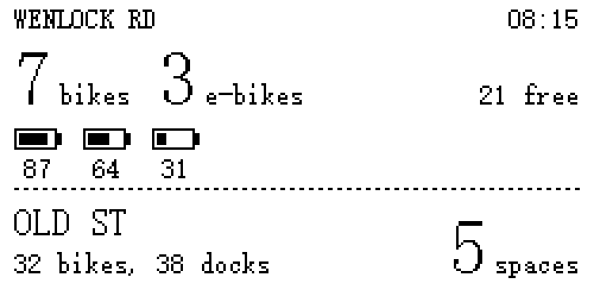

# Dock display

A 2.13" e-paper display that shows live Santander Cycles numbers for two fixed docks:

- **Home dock** (Wenlock Road): classic bikes, e-bikes, each e-bike's battery, free spaces.
- **Destination dock** (Old Street): free spaces to drop off, or **FULL**.



The layout is a placeholder that shows every value the device fetches. The interface is
still to be designed. The firmware is adapted from the sunday-display project: the
e-paper driver layer, deep sleep and button handling are reused, and Apps Script and the
calendar logic are gone.

## How it gets the data

```
TfL Unified API ─────── per-dock counts (~3 KB each) ──┐
api.tfl.gov.uk/BikePoint/BikePoints_<id>                v
                                                    ESP32-S3 ──> 250x122 e-paper
Santander Cycles GraphQL ── all of London, streamed ──^
santandercycles.tfl.gov.uk/bikesharefe-gql   (only our two docks are kept)
```

It uses the same two sources as the iOS app (`CycleHireService`, `EBikeBatteryService`),
called straight from the device. There's no Apps Script and no server of our own.

- **Counts** come from TfL's BikePoint endpoint, one small request per dock. If TfL fails,
  the counts come from the GraphQL feed instead.
- **Batteries** come from the GraphQL feed. It only answers for all of London at once, so
  the query asks for only the fields the screen needs, and `santander.cpp` parses the
  answer one station at a time as it arrives. It keeps the two docks and closes the
  connection once both are found. Memory use stays at a few KB, whatever the answer's size.
- The GraphQL `stationId` is the number in TfL's `BikePoints_<n>`, the same match the
  app makes.
- **Dock IDs:** with `*_DOCK_ID 0` in `config.h`, the first fetch finds each dock with
  TfL's search (`/BikePoint/Search?query=…`), takes the match whose name starts with the
  query, saves the ID in flash and prints every match to the serial log. Put the ID in
  `config.h` once it's confirmed. OpenStreetMap lists Wenlock Road as 42.

### Why no Apps Script

Sunday-display needed Apps Script because Google Calendar needs OAuth, which doesn't fit
on the device. Both cycle APIs are public, unauthenticated HTTPS + JSON, so the ESP32 can
call them directly. That removes a deployment, a token and the 2–5 s Apps Script
start-up delay from every fetch.

A proxy (Apps Script, or a Cloudflare Worker) would be worth adding back if:

- the GraphQL endpoint starts refusing non-browser clients or needs cookies,
- the all-London download turns out too slow or too costly on battery, since a proxy
  could return ~200 bytes, or
- TfL changes its formats often, since a proxy can be fixed without reflashing.

## Screens

Reference renders (3x) from the desktop preview, in `docs/renders/`:

| Render | When |
| --- | --- |
| `01_typical` | bikes, e-bikes with battery bars (fullest first), free spaces at both docks |
| `02_many_ebikes` | more e-bikes than fit: the seven fullest, then "+N" |
| `03_home_empty_dest_full` | **EMPTY** at home, **FULL** at the destination |
| `04_stale_battery_na` | "!" = last fetch failed, older counts shown; battery feed down |
| `05_updating` | a button press is fetching fresh data |
| `06_dest_closed` | a dock that's locked, not installed or offline |
| `08_no_data` | before the first successful fetch |
| `10_status` | Menu: last sync, Wi-Fi or last error, next wake, dock IDs, firmware |

The time in the top right is when the counts were last fetched.

## Controls and refresh

| Control | Does |
| --- | --- |
| Any key except Menu | Fetch fresh data now (a press within 20 s of the last fetch just redraws) |
| Menu | Status screen; Menu or Back to leave |

Any key wakes it from deep sleep. It shows the saved numbers at once with "updating",
fetches, then redraws. After 30 s without a press it sleeps again.

It also wakes on a timer: every 5 minutes from 07:00 to 10:00 on weekdays, every 30 minutes
otherwise, and not at all from 23:00 to 06:00. All of these are in `config.h`. Timer
wakes use a partial refresh, with a full flash every 15 updates to clear ghosting.

## Setup

1. Get Elecrow's driver files (default panel `jd79661`, see Hardware):
   ```bash
   ./tools/fetch_driver.sh
   ```
2. Copy `firmware/dock_display/config.example.h` to `config.h` in the same folder, and
   fill in your Wi-Fi details. The docks are already set.
3. Build and flash. Same toolchain as sunday-display: ESP32 core 3.x, ArduinoJson v7.
   ```bash
   arduino-cli compile -b esp32:esp32:esp32s3:FlashSize=8M firmware/dock_display
   ```
   ```bash
   arduino-cli upload -b esp32:esp32:esp32s3:FlashSize=8M -p /dev/cu.wchusbserial10 firmware/dock_display
   ```
4. Watch the serial log (115200 baud) on the first boot. A good run looks like:
   ```
   boot: fw 0.1.0, wake cause 0
   wifi: ok, -60 dBm
   ntp: ok
   dock: 'Wenlock Road' matches BikePoints_<n> "<name>"
   dock: using BikePoints_<n> "<name>" for WENLOCK RD
   dock: 'Old Street Station' matches BikePoints_<n> "<name>"
   dock: using BikePoints_<n> "<name>" for OLD ST
   tfl <n>: <name>
   tfl <n>: <name>
   gql: read <N> stations, found 2 of 2
   gql: ok
   dock <n>: <b> bikes, <e> e-bikes, <s> spaces, <k> batteries
   dock <n>: ...
   sleep 300 s
   ```
   Check that the matched docks are the right ones, then put their IDs in `config.h`.

### Desktop preview

```bash
./tools/fetch_driver.sh && ./tools/preview/build.sh   # PNGs in tools/preview/out/
```

This renders every screen with the real drawing code and fonts. It also checks the
battery sorting. Sample data is in `tools/preview/preview.cpp`. Use it to iterate on the
interface without flashing.

## Hardware

CrowPanel ESP32-S3 2.13" E-paper HMI (Elecrow). The panel notes from sunday-display apply
unchanged, because `epd_io.*` and `gfx.*` are copied from it as they were:

- 250x122, black and white. Panel power is GPIO 7. Buttons are active low: Menu 2,
  Back 1, dial up 6, dial down 4, dial press 5.
- **JD79661 controller** on the v1.2 board (the default in `fetch_driver.sh`), or the
  SSD1680 on older boards (`./tools/fetch_driver.sh ssd1680`). `epd_io.cpp` tells them
  apart by `EPD_H`. If the log stops at `epd: full` and the screen never changes, it's
  the other one.
- The frame is mirrored in software on the JD79661 (`EPD_MIRROR_X`). Don't use Elecrow's
  `lut_GC`/`lut_DU` or v1.2 `EPD_ALL_Fill`/`EPD_PartUpdate`.
- Fonts are 12/16/24/32/48 px tall and half as wide, ASCII only.

## Layout

```
firmware/dock_display/
  dock_display.ino    wake/sleep, buttons, fetch flow, dock ID lookup
  config.example.h    copy to config.h (git-ignored): Wi-Fi, docks, cadence
  docks.h             data model (no Arduino deps)
  santander.h/.cpp    TfL BikePoint + search, GraphQL battery feed (streamed)
  render.h/.cpp       every screen, pure drawing
  gfx.*, epd_io.*     from sunday-display, unchanged
  net.h/.cpp          Wi-Fi and NTP
tools/
  fetch_driver.sh     copies Elecrow's driver files into the sketch
  preview/            desktop preview: renders every screen to PNG
docs/renders/         reference renders
```

Don't commit `config.h` or Elecrow's driver files; `.gitignore` covers both.

## Verify on hardware (untested assumptions)

The firmware hasn't been compiled for the ESP32 or run yet. It was written in a sandbox
that couldn't reach TfL or download the ESP32 toolchain. The drawing code and the
streaming reader were built and tested on a desktop.

1. **Compile.** Check for API slips against ESP32 core 3.x (`HTTPClient`,
   `NetworkClient`) and ArduinoJson v7.
2. **GraphQL from the ESP32.** The request matches the iOS app's, with a trimmed field
   list. Check that it answers a non-browser `User-Agent` and HTTP/1.0 (`useHTTP10`, so
   the body isn't chunked; a chunked body is decoded anyway). Check the
   `gql: read N stations` line and how long the fetch takes.
3. **Count fields.** TfL's `NbBikes` is taken to include e-bikes, with
   `NbStandardBikes` as the classic ones. GraphQL's `bikesAvailable` is taken to be
   classic only. Compare a dock on screen with the Santander app.
4. **Battery range units.** `distanceRemaining.unit` is assumed to start with "m"
   (miles) or "k" (km). Range is stored but not drawn yet.
5. **TLS** uses `setInsecure()`. Pin the root CAs once it works.
6. **Partial refresh on timer wakes** (JD79661). Unverified on screen in sunday-display
   too. If it ghosts, set `FULL_REFRESH_EVERY 0`.
7. **Power.** A 5-minute cadence over three hours is 36 Wi-Fi wakes, each with three TLS
   handshakes and the London-wide download. Measure it before running on battery.
