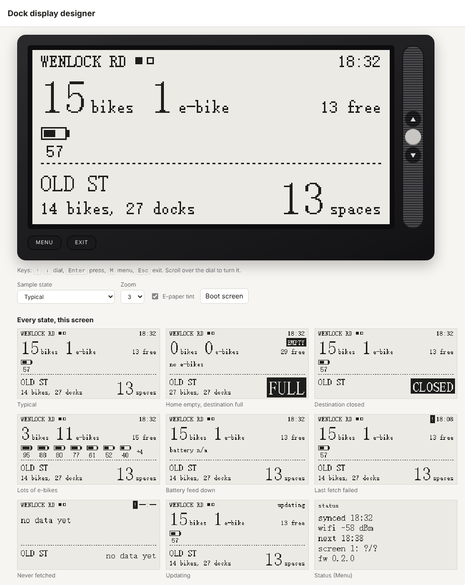

# Dock display

A 2.13" e-paper display that shows live Santander Cycles numbers for up to four
screens. Turn the dial to switch between them. Each screen is a pair of docks:

- **Home dock** (top): classic bikes, e-bikes, each e-bike's battery, free spaces.
- **Destination dock** (bottom): free spaces to drop off, or **FULL**.

The screens are set in [`docks.json`](docks.json). It ships with Wenlock Road → Old
Street, and the reverse.


The layout is a placeholder that shows every value the device fetches. The interface
is still to be designed, and the [designer](#designer) is the place to do it. The
firmware is adapted from the sunday-display project: the e-paper driver layer, deep
sleep and button handling are reused, and Apps Script and the calendar logic are gone.

The screen is always black on a white (light) background. Nothing switches it to a
dark mode. The designer shows it on a light paper tint, whatever your computer's
theme.

## How it gets the data

```
TfL Unified API ─────── per-dock counts (~3 KB each) ──┐
api.tfl.gov.uk/BikePoint/BikePoints_<id>                v
                                                    ESP32-S3 ──> 250x122 e-paper
Santander Cycles GraphQL ── all of London, streamed ──^
santandercycles.tfl.gov.uk/bikesharefe-gql   (only our docks are kept)
```

It uses the same two sources as the iOS app (`CycleHireService`, `EBikeBatteryService`),
called straight from the device. There's no Apps Script and no server of our own.

- **Counts** for the screen on display come from TfL's BikePoint endpoint, one small
  request per dock.
- **Batteries** come from the GraphQL feed. It only answers for all of London at once, so
  one request covers every screen's docks. The query asks for only the fields the screen
  needs. `santander.cpp` parses the answer one station at a time as it arrives, keeps
  our docks, and closes the connection once it has them all. Memory use stays at a few KB,
  whatever the answer's size.
- **The other screens' counts** come from the same GraphQL answer, so turning the dial
  shows recent numbers without another fetch. GraphQL counts also fill in if TfL fails.
- The GraphQL `stationId` is the number in TfL's `BikePoints_<n>`, the same match the
  app makes.
- **Docks without an ID:** `docks.json` can give a search phrase (`"query"`) in place of
  an ID. The first fetch finds the dock with TfL's search (`/BikePoint/Search?query=…`),
  takes the match whose name starts with the phrase, saves the ID in flash and prints
  every match to the serial log. The designer replaces the phrase with a real ID when you
  pick the dock from its list.

### Why no Apps Script

Sunday-display needed Apps Script because Google Calendar needs OAuth, which doesn't fit
on the device. Both cycle APIs are public, unauthenticated HTTPS + JSON, so the ESP32 can
call them directly. That removes a deployment, a token and the 2–5 s Apps Script
start-up delay from every fetch.

A proxy (Apps Script, or a Cloudflare Worker) would be worth adding back if:

- the GraphQL endpoint starts refusing non-browser clients or needs cookies,
- the all-London download turns out too slow or too costly on battery, since a proxy
  could return ~200 bytes, or
- TfL changes its formats often, since a proxy can be fixed without reflashing.

## Choosing docks: docks.json

```json
{
  "screens": [
    {
      "home": { "id": 0, "query": "Wenlock Road", "name": "Wenlock Road", "label": "WENLOCK RD" },
      "dest": { "id": 0, "query": "Old Street Station", "name": "Old Street Station", "label": "OLD ST" }
    }
  ]
}
```

- 1 to 4 screens, each with a `home` and a `dest` dock.
- `id` is the number in TfL's `BikePoints_<n>`. With `id` 0, the device searches for
  `query` instead (see above).
- `label` is what the screen shows: printable ASCII, at most 16 characters (the panel
  font has nothing else).
- `name` is TfL's full name, for people reading the file. It isn't sent to the device.

The easiest way to edit it is the designer: pick docks from TfL's list, then **Save**.
Arduino can't read JSON while compiling, so `tools/docks_json.py` turns `docks.json`
into `firmware/dock_display/docks_config.h`. It also checks the file and says what's
wrong. `tools/flash.sh` runs it before every build, and the designer runs it on save.
The header is generated, so it's git-ignored.

```bash
python3 tools/docks_json.py --check
```

## Designer

A local web page with a working mock of the device, for designing the screen and
choosing docks.

```bash
./tools/fetch_driver.sh                 # once: Elecrow's fonts and drawing code
python3 tools/designer/serve.py         # then open http://localhost:8250
```



- **The mock is the firmware.** Each frame is drawn by the firmware's own `render.cpp`,
  and each button press is decided by its own `ui.h`, compiled on your computer with the
  Xcode command line tools. The browser shows exactly what the panel will. Edit
  `render.cpp` and the page redraws by itself; the server rebuilds the renderer when a
  source file changes.
- **Buttons.** Scroll over the dial (or click its arrows, or press <kbd>↑</kbd>
  <kbd>↓</kbd>) to change screens. Click its middle, or press <kbd>Enter</kbd>, to fetch.
  **MENU** (<kbd>M</kbd>) shows the status screen, and **EXIT** (<kbd>Esc</kbd>) goes
  back. Scrolling onto a screen with old numbers fetches after 1.5 s, as on the device.
- **Data.** *Sample data* has states to design for: typical, empty/full, closed, lots of
  e-bikes, battery feed down, last fetch failed, never fetched. *Live from TfL* makes
  the same two calls as the device, through the local server, since a web page can't
  call the battery feed itself.
- **Every state at once.** Under the device, the current screen is drawn in every
  state, including "updating" and the status screen.
- **Screens.** Pick each dock from TfL's list (type to search, or type an ID). Labels
  fill in from the dock name ("Wenlock Road , Hoxton" → "WENLOCK RD"), and you can edit
  them. **Save** writes `docks.json` and `docks_config.h`. You can also download or import
  the JSON.

The server listens on `127.0.0.1` only and uses Python's standard library.

## Screens

Reference renders (3x) from the desktop preview, in `docs/renders/`:

| Render | When |
| --- | --- |
| `01_typical` | bikes, e-bikes with battery bars (fullest first), free spaces at both docks |
| `02_many_ebikes` | more e-bikes than fit: the seven fullest, then "+N" |
| `03_home_empty_dest_full` | **EMPTY** at home, **FULL** at the destination |
| `04_stale_battery_na` | "!" = the last fetch didn't refresh this screen; battery feed down |
| `05_updating` | a fetch is under way |
| `06_dest_closed` | a dock that's locked, not installed or offline |
| `07_screen_2_of_4` | the page dots after the home label: which screen this is |
| `08_no_data` | before the first successful fetch |
| `10_status` | Menu: last sync, Wi-Fi or last error, next wake, this screen's dock IDs, firmware |

The time in the top right is when the screen's numbers last arrived.

## Controls and refresh

| Control | Does |
| --- | --- |
| Dial up / down | Previous / next screen (wraps round); also leaves the status screen |
| Dial press | Fetch fresh data now (a press within 20 s of the last fetch just redraws) |
| Exit (Back) | Leave the status screen, or go to the first screen |
| Menu | Status screen on / off |

The logic is in `ui.h`, which the designer uses too.

Any key wakes it from deep sleep and acts at once on the saved numbers. If the screen
it lands on has numbers more than 2 minutes old, it fetches once the dial has been still
for 1.5 s, showing "updating" meanwhile. After 30 s without a press it sleeps again. It
remembers the screen you left it on until it loses power.

It also wakes on a timer: every 5 minutes from 07:00 to 10:00 on weekdays, every 30
minutes otherwise, and not at all from 23:00 to 06:00. All of these timings are in
`config.h`. Timer wakes use a partial refresh, with a full flash every 15 updates to
clear ghosting.

## Setup

1. Get Elecrow's driver files (default panel `jd79661`, see Hardware):
   ```bash
   ./tools/fetch_driver.sh
   ```
2. Copy `firmware/dock_display/config.example.h` to `config.h` in the same folder, and
   fill in your Wi-Fi details. A `config.h` from 0.1.0 still works; its `*_DOCK_*`
   lines are ignored now.
3. Choose docks with the designer, or edit `docks.json`.
4. Build and flash. Same toolchain as sunday-display: ESP32 core 3.x, ArduinoJson v7.
   The script makes `docks_config.h` from `docks.json` first.
   ```bash
   ./tools/flash.sh /dev/cu.wchusbserial10
   ```
   Without a port it only compiles. `FQBN=...` overrides the board.
5. Watch the serial log (115200 baud) on the first boot. A good run looks like:
   ```
   boot: fw 0.2.0, wake cause 0, screen 1 of 2
   wifi: ok, -60 dBm
   ntp: ok
   dock: 'Wenlock Road' matches BikePoints_<n> "<name>"
   dock: using BikePoints_<n> "<name>" for WENLOCK RD
   dock: 'Old Street Station' matches BikePoints_<n> "<name>"
   dock: using BikePoints_<n> "<name>" for OLD ST
   tfl <n>: <name>
   tfl <n>: <name>
   gql: read <N> stations, found 4 of 4
   gql: ok
   slot 0 dock <n>: <b> bikes, <e> e-bikes, <s> spaces, <k> batteries
   ...
   sleep 300 s
   ```
   Docks found by search are printed here. Check they're the right ones, or pick them in
   the designer to save their IDs.

### Desktop preview

```bash
./tools/fetch_driver.sh && ./tools/preview/build.sh   # PNGs in tools/preview/out/
```

This renders the reference screens to PNG files, and checks the battery sorting and the
button logic. The designer is the interactive version.

## Hardware

CrowPanel ESP32-S3 2.13" E-paper HMI (Elecrow). The panel notes from sunday-display apply
unchanged, because `epd_io.*` and `gfx.*` are copied from it as they were:

- 250x122, black and white. Panel power is GPIO 7. Buttons are active low: Menu 2,
  Back 1, dial up 6, dial down 4, dial press 5.
- **JD79661 controller** on the v1.2 board (the default in `fetch_driver.sh`), or the
  SSD1680 on older boards (`./tools/fetch_driver.sh ssd1680`). `epd_io.cpp` tells them
  apart by `EPD_H`. If the log stops at `epd: full` and the screen never changes, it's
  the other one.
- The frame is mirrored in software on the JD79661 (`EPD_MIRROR_X`). Don't use Elecrow's
  `lut_GC`/`lut_DU` or v1.2 `EPD_ALL_Fill`/`EPD_PartUpdate`.
- Fonts are 12/16/24/32/48 px tall and half as wide, ASCII only.

## Layout

```
docks.json            the screens and their docks
firmware/dock_display/
  dock_display.ino    wake/sleep, buttons, fetch flow, dock ID lookup
  config.example.h    copy to config.h (git-ignored): Wi-Fi, timings
  docks_config.h      generated from docks.json (git-ignored)
  docks.h             data model (no Arduino deps)
  ui.h                what each button does (shared with the designer)
  santander.h/.cpp    TfL BikePoint + search, GraphQL battery feed (streamed)
  render.h/.cpp       every screen, pure drawing
  gfx.*, epd_io.*     from sunday-display, unchanged
  net.h/.cpp          Wi-Fi and NTP
tools/
  docks_json.py       docks.json -> docks_config.h, with checks
  flash.sh            make the header, compile, upload
  fetch_driver.sh     copies Elecrow's driver files into the sketch
  designer/           local web designer: serve.py, page, native renderer
  preview/            renders the reference screens to PNG
docs/renders/         reference renders
```

Don't commit `config.h`, `docks_config.h` or Elecrow's driver files; `.gitignore` covers
them. Elecrow's repo has no licence, which is why their files are fetched rather than
committed. The designer compiles them on your computer for the same reason.

## Verify on hardware (untested assumptions)

0.1.0 ran on the board. 0.2.0 (screens, `docks.json`, `ui.h`) hasn't been compiled
for the ESP32 or flashed yet. It passed a syntax check against stub headers, and the
designer runs its button and drawing code.

1. **Compile 0.2.0.** Check for API slips against ESP32 core 3.x and ArduinoJson v7.
2. **Scrolling.** Each dial step should switch screens with a partial refresh, and a
   fetch should start 1.5 s after the dial stops on a screen with old numbers. Check the
   dial doesn't skip or double-step; the debounce is 25 ms.
3. **RTC memory.** Every screen's docks are kept across deep sleep (about 0.8 KB), next
   to the 4 KB last frame. That should fit in the 8 KB RTC memory.
4. **GraphQL from the ESP32.** Check the `gql: read N stations, found X of Y` line now
   that it looks for up to eight docks, and how long the fetch takes.
5. **Count fields.** TfL's `NbBikes` is taken to include e-bikes, with
   `NbStandardBikes` as the classic ones. GraphQL's `bikesAvailable` is taken to be
   classic only. Compare a dock on screen with the Santander app.
6. **Battery range units.** `distanceRemaining.unit` is assumed to start with "m"
   (miles) or "k" (km). Range is stored but not drawn yet.
7. **TLS** uses `setInsecure()`. Pin the root CAs once it works.
8. **Partial refresh on timer wakes** (JD79661). If it ghosts, set
   `FULL_REFRESH_EVERY 0`.
9. **Power.** A 5-minute cadence over three hours is 36 Wi-Fi wakes, each with three TLS
   handshakes and the London-wide download. Measure it before running on battery.
